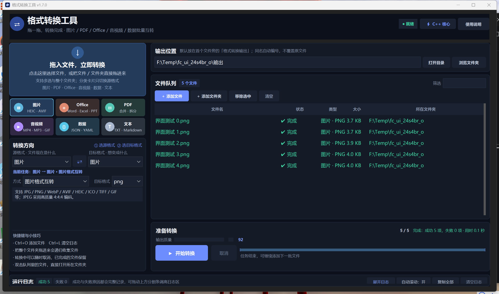

# Format Converter

**A zero-setup batch format converter for Windows.** Images, PDF, Office documents, audio/video and structured data all live in one window. Drag files in, pick a direction, hit Start — no ads, no accounts, no network calls.

> **Since v1.6.0 the conversion core is C++17** (`cpp/`, CMake). Python/Tkinter now only handles the UI, queue and progress; desktop calls `bin/fccli.exe`, and Android reuses the same core through JNI. A pure-Python fallback remains in `converters_legacy.py`.

[English](README.md) | [简体中文](README.zh-CN.md)

[](https://github.com/8848sing/format-converter/actions/workflows/ci.yml)




> Format Converter is a portable Windows batch conversion toolbox built with Tkinter — 30 conversion modes across images, PDF, Office documents, audio/video and structured data. No ads, no accounts, no telemetry.

## Why this one

- **One entry point, 30 conversion modes.** Stop hunting for a different online tool every time you need a format.
- **Truly batch.** Drop a whole folder in: images, PDF, audio/video and data conversions run in parallel across threads. Image batches scale to the CPU's logical thread count (up to 16 workers), and MP4 output uses NVENC hardware encoding when an NVIDIA GPU is present: 20 s of 1080p went from 6.4 s to 2.7 s.
- **Cancellable and non-destructive.** Stop the remaining queue at any time; colliding output names get `_1`, `_2` suffixes, and source files are never touched.
- **Fully local.** Every conversion happens on your machine — no uploads, no network, no data collection.
- **Portable.** The single exe handles images, PDF, data and text. Add the `tools/` directory and Office plus audio/video work too.
- **Photos stay upright.** EXIF orientation is applied automatically, so phone shots never come out sideways or upside down.

## What it converts

| Category | Input | Capabilities |
| --- | --- | --- |
| Image | JPG, PNG, WebP, AVIF, HEIC/HEIF, ICO, TIFF, BMP, GIF, TGA, PPM | Convert between formats, one image per PDF, merge several into one PDF, build looping GIFs |
| PDF | PDF | To images (one per page), editable Word, Excel, PowerPoint, plain text; merge, split per page, rotate, compress content streams |
| Word | DOC, DOCX, RTF, ODT | To PDF, to images, to plain text; convert among doc/docx/odt/rtf |
| Excel | XLS, XLSX, ODS, CSV | To PDF, to images; convert among xlsx/xls/ods/csv; to JSON |
| PowerPoint | PPT, PPTX, ODP | To PDF, to images; convert among pptx/ppt/odp |
| Text | TXT, Markdown | To PDF, to Word |
| Audio | MP3, WAV, FLAC, M4A, AAC, OGG, OPUS, WMA, AIFF, AMR | Output MP3 / WAV / FLAC / M4A / AAC / OGG / OPUS / WMA |
| Video | MP4, M4V, MKV, MOV, WebM, AVI, WMV, FLV, TS, MTS, M2TS, 3GP | Output MP4 / MKV / MOV / WebM / AVI / WMV / GIF, or extract audio (MP4/MKV/MOV use NVENC hardware encoding when an NVIDIA GPU is available, with automatic fallback to software) |
| Data | JSON, YAML, XML, XLSX, CSV | JSON / YAML / XML interconversion, flatten into Excel, tables to JSON |

The full registry is `CONVERSIONS` in [`converters.py`](converters.py) — 30 entries.

## Quick start

### Option 1: download a release

Grab `格式转换工具.exe` from the [Releases](../../releases) page and double-click it. On first launch SmartScreen may warn about an "unknown publisher" because the project has no code-signing certificate — choose "More info → Run anyway".

### Option 2: run from source

```powershell
git clone https://github.com/8848sing/format-converter.git
cd format-converter
python -m pip install -r requirements.txt
python main.py
```

Requires Windows 10/11 and Python 3.11 or 3.12 (`pdf2docx` usually lags behind new Python releases).

### Option 3: build the C++ core (recommended)

Requirements: CMake 3.20+ and a C++17 compiler (MSVC 2022 / MinGW-w64). PDFium is a prebuilt package:

```powershell
# extract pdfium-win-x64.tgz into cpp/third_party/pdfium-win first
cmake -S cpp -B cpp/build -G "Visual Studio 17 2022" -A x64 `
  -DFC_PDFIUM_DIR="$PWD/cpp/third_party/pdfium-win"
cmake --build cpp/build --config Release
```

`bin/fccli.exe` and `bin/pdfium.dll` are copied automatically and the Python UI will use them.
See [`cpp/README.zh-CN.md`](cpp/README.zh-CN.md) for the full build, CLI, C API and feature matrix.

### Self-test

```powershell
python main.py --self-test
```

Runs the C++ core's basic `fccli self-test` (image/PDF/data smoke plus LibreOffice/FFmpeg detection) when available, falling back to the legacy full Python test, and writes the result to `self-test-result.json`. Without `tools/`, the Office and FFmpeg entries are reported as failures.

## About `tools/`

Office and audio/video conversion depend on two external programs that are far too large for version control (about 1.06 GB combined). Place them yourself:

```text
tools/
├─ FFmpeg/ffmpeg.exe
└─ LibreOffice/program/soffice.exe
```

- FFmpeg: download an LGPL build from [BtbN/FFmpeg-Builds](https://github.com/BtbN/FFmpeg-Builds) and extract it into `tools/FFmpeg/`.
- LibreOffice: [LibreOffice Portable](https://www.libreoffice.org/download/portable-versions/) works; extract it into `tools/LibreOffice/`.

Alternatively create `settings.json` next to the executable and point at existing installs:

```json
{
  "ffmpeg": "tools/FFmpeg/ffmpeg.exe",
  "soffice": "C:/Program Files/LibreOffice/program/soffice.exe"
}
```

Sources, versions, SHA-256 hashes and the verification steps are in [`THIRD_PARTY_SECURITY.md`](THIRD_PARTY_SECURITY.md).

## Building

```powershell
python -m pip install -r requirements.txt pyinstaller
python -m PyInstaller --clean --noconfirm 格式转换工具.spec
```

The artifact is `dist/格式转换工具.exe`. The spec disables UPX to reduce antivirus false positives and keeps FFmpeg external. `build/`, `dist/` and `*.exe` are all git-ignored — ship builds through GitHub Releases.

## Project layout

```text
├─ main.py                  # entry point: high-DPI, --version, --self-test
├─ ui.py                    # Tkinter / ttkbootstrap UI and thread scheduling
├─ converters.py            # registry + C++ bridge (C++ first, Python fallback)
├─ converters_legacy.py     # v1.5 pure-Python implementation (fallback only)
├─ cpp_bridge.py            # invokes bin/fccli.exe and parses JSON events
├─ cpp/                     # C++17 core: CMake, PDFium, libwebp, yaml-cpp
│  ├─ src/                  # image/PDF/Office/media/data implementations
│  ├─ include/fc/core.h     # stable C API (JNI/ctypes)
│  ├─ android/              # Android JNI + Gradle shell
│  └─ README.zh-CN.md       # C++ build and feature matrix
├─ bin/                     # fccli.exe + pdfium.dll (build output, git-ignored)
├─ version.py               # single source of truth for the version string
├─ self_test.py             # C++-first full-feature self-test
├─ tests/test_registry.py   # registry structure test (no third-party deps)
├─ docs/screenshot.png      # UI screenshot
├─ tools/                   # LibreOffice / FFmpeg, git-ignored
├─ requirements.txt
└─ 格式转换工具.spec         # PyInstaller configuration (bundles bin/)
```

## Design notes

- Conversion logic is isolated from the UI: `converters.py` only uses the standard library plus lazily imported third-party packages, so startup never loads heavy dependencies.
- One error type: failures raise `ConvertError`, the UI catches it per file, and a single bad file never aborts the batch.
- Bounded concurrency: 2–4 worker threads per task type (image batches scale to the logical CPU count, up to 16), with at most 2× the tasks queued ahead, so tens of thousands of files don't exhaust memory.
- Output reservations: a lock registers allocated filenames during parallel conversion, so two workers can never write the same path.
- External programs are always invoked with argument arrays, never through a shell, so filenames are never interpreted as commands.

## Changelog

### Unreleased (fixes and tuning on main)

- **Fixed: audio/video conversion froze from the GUI.** Child processes inherited `fccli`'s stdin (a pipe that stays open), so FFmpeg blocked waiting for input: no progress, 0% CPU, 0-byte output, until the 30-minute timeout. Child stdin now goes to NUL and FFmpeg gets `-nostdin`; 20 s of 1080p now takes 2.8 s (MP4), 2.9 s (MKV) and 0.3 s (MP3 extraction).
- **Hardware video encoding**: MP4/MKV/MOV output probes `ffmpeg -encoders` and uses `h264_nvenc` (`-cq 28 -maxrate 16M`) when available — 1080p30 went from 6.4 s to 2.7 s with better SSIM (0.993 vs 0.982); falls back to `libopenh264` if NVENC cannot initialize.
- **Image concurrency fills the CPU**: automatic worker count raised from a hard cap of 8 to the logical thread count (max 16).
- **Window sizes itself to the work area**: uses the Windows work area (minus the taskbar) instead of dividing the screen size by the scale factor, so a 2560×1440 display at 150% no longer opens a 1678×959 window; restored geometry is clamped back on screen.
- **Drop-zone copy no longer clipped**: the card grew to fit all four lines of text.

### v1.7.0 (desktop)

- **One process per batch**: a whole batch goes to a single `fccli` process that runs the files concurrently; 40 small images dropped from 0.80 s to 0.22 s.
- **Real cancellation**: `fccli convert --job-line -` accepts a cancel command on stdin and stops between files, leaving no `.part` leftovers.
- **Leaner build**: dropped the OpenCV / PyMuPDF / pdf2docx stack that only the Python fallback used — the EXE went from **127.6 MB to 56.5 MB**, startup about 25% faster.
- **AVIF works**: when the system has no AVIF encoder, it falls back to `tools/FFmpeg` (libsvtav1); the quality slider applies too.
- **Sturdier Office**: child process trees are hosted in a Windows job object, so a timeout kills the whole tree (no orphaned `soffice.bin` blocking later conversions); per-file timeout trimmed to 120 s.
- **Word-to-text uses the built-in extractor by default**: `.docx` goes through `docx_text` (0.14 s), `.doc`/`.rtf`/`.odt` still use LibreOffice with automatic fallback; switchable in Settings.
- **UI**: per-file status column, image quality slider, render DPI, worker count, one-click retry of failed files, queue keyword filter, engine badge, settings dialog, remembered preferences, collapsible log, completion beep; window no longer overflows the screen on HiDPI.
- **Packaging**: the EXE declares per-monitor v2 DPI awareness, so the UI is no longer blurry at 125%/150% scaling.
- Added `sync_version.py` (one command for the three version locations) and `settings_store.py` (atomic `settings.json` access).

### v1.6.0

- **C++17 core migration**: added `cpp/`, `fccli.exe`, `fccore.dll` and a stable C API; images, PDF, Office, audio/video and data conversions are dispatched by C++.
- **Android groundwork**: `cpp/android/` JNI bridge, Java UI and Gradle project; first Android scope covers images, PDF and data.
- The Python UI is now "C++ first, Python fallback"; `converters_legacy.py` keeps the old implementation.
- Vendored stb, libwebp, PDFium, yaml-cpp, miniz, tinyxml2 and gif.h; Office/FFmpeg still reuse `tools/`.
- Fixed Windows narrow-string path handling for Chinese/spaced paths; outputs use atomic `.part` writes.
- Self-test prefers `fccli self-test`; PyInstaller bundles `bin/fccli.exe` and `bin/pdfium.dll`.

### v1.5.0

- Image batch conversion now scales to CPU cores (up to 8 workers), for higher throughput on multi-core machines.
- WebP switched to a faster encoder preset: roughly 40% faster at about the same file size.
- PNG dropped the low-yield exhaustive compression search: about twice as fast.
- Phone photos now apply EXIF orientation automatically — no more sideways or inverted output.
- PDF-to-text now uses pypdfium2's native extraction, noticeably faster on large documents, with automatic fallback to pdfplumber.
- Added an "Open folder" button next to the output location; double-clicking a queue item opens its folder.
- Fixed: empty Office output files were counted as successes; batch-level failures left the progress bar stuck and success/failure counts mismatched.
- Fixed: image-to-PDF and PDF merge did not release file handles promptly; memory peak is now lower for large batches.

## Known limitations

- **PDF to Word / Excel** uses the native C++ implementation: it extracts the text layer into DOCX/XLSX; layout and table fidelity is lower than `pdf2docx`, and scanned documents need OCR first.
- PDF to PowerPoint is a "page images" conversion — the text is not editable.
- PDF compression rewrites the document structure; embedded high-resolution images are not re-encoded.
- **AVIF encoding** depends on a system WIC codec; Windows usually does not ship one, so the app asks you to use PNG/WebP. HEIC/AVIF **decoding** also depends on the system extension; TIFF/ICO use WIC.
- Without `tools/` in the package, Office and audio/video conversion report that LibreOffice / FFmpeg cannot be found.
- Android v1 does not support Office or audio/video yet (requires additional LibreOffice/FFmpeg integration); image input covers JPEG/PNG/WebP/BMP/GIF/TGA/PPM/ICO, while HEIC/TIFF/AVIF still need an Android Bitmap decoder bridge.
- There is no commercial code-signing certificate, so SmartScreen may warn about an unknown publisher.
- The application UI is currently in Chinese only; the documentation here is bilingual.

## Android

The C++ core ships with a JNI bridge and a Java shell under [`cpp/android/`](cpp/android/README.zh-CN.md).
The first version covers images, PDF and data conversions; Office/audio-video will follow with FFmpeg and a document engine.
Building requires Android Studio, NDK 27 and the prebuilt PDFium Android packages.

## Contributing

Issues and pull requests are welcome — please read [`CONTRIBUTING.md`](CONTRIBUTING.md) first. CI runs Ruff, a compile check and the registry tests.

## License

Released under the [MIT License](LICENSE). The bundled FFmpeg is an LGPL build and LibreOffice is MPL 2.0; each follows its own license — see [`THIRD_PARTY_SECURITY.md`](THIRD_PARTY_SECURITY.md).