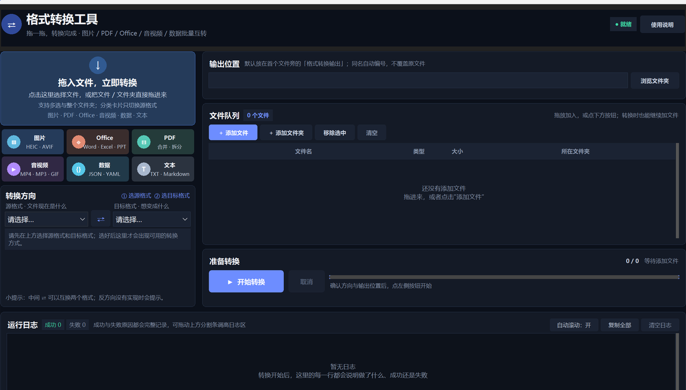

# Format Converter

**A zero-setup batch format converter for Windows.** Images, PDF, Office documents, audio/video and structured data all live in one window. Drag files in, pick a direction, hit Start — no ads, no accounts, no network calls.

[English](README.md) | [简体中文](README.zh-CN.md)

[](../../actions/workflows/ci.yml)




> Format Converter is a portable Windows batch conversion toolbox built with Tkinter — 30 conversion modes across images, PDF, Office documents, audio/video and structured data. No ads, no accounts, no telemetry.

## Why this one

- **One entry point, 30 conversion modes.** Stop hunting for a different online tool every time you need a format.
- **Truly batch.** Drop a whole folder in: images, PDF, audio/video and data conversions run in parallel across threads. Converting 8 images at 3200×2000 to WebP went from 8.4 s to 2.6 s.
- **Cancellable and non-destructive.** Stop the remaining queue at any time; colliding output names get `_1`, `_2` suffixes, and source files are never touched.
- **Fully local.** Every conversion happens on your machine — no uploads, no network, no data collection.
- **Portable.** The single exe handles images, PDF, data and text. Add the `tools/` directory and Office plus audio/video work too.
- **Photos stay upright.** EXIF orientation is applied automatically, so phone shots never come out sideways or upside down.

## What it converts

| Category | Input | Capabilities |
| --- | --- | --- |
| Image | JPG, PNG, WebP, AVIF, HEIC/HEIF, ICO, TIFF, BMP, GIF, TGA, PPM | Convert between formats, one image per PDF, merge several into one PDF, build looping GIFs |
| PDF | PDF | To images (one per page), editable Word, Excel, PowerPoint, plain text; merge, split per page, rotate, compress content streams |
| Word | DOC, DOCX, RTF, ODT | To PDF, to images, to plain text; convert among doc/docx/odt/rtf |
| Excel | XLS, XLSX, ODS, CSV | To PDF, to images; convert among xlsx/xls/ods/csv; to JSON |
| PowerPoint | PPT, PPTX, ODP | To PDF, to images; convert among pptx/ppt/odp |
| Text | TXT, Markdown | To PDF, to Word |
| Audio | MP3, WAV, FLAC, M4A, AAC, OGG, OPUS, WMA, AIFF, AMR | Output MP3 / WAV / FLAC / M4A / AAC / OGG / OPUS / WMA |
| Video | MP4, M4V, MKV, MOV, WebM, AVI, WMV, FLV, TS, MTS, M2TS, 3GP | Output MP4 / MKV / MOV / WebM / AVI / WMV / GIF, or extract audio |
| Data | JSON, YAML, XML, XLSX, CSV | JSON / YAML / XML interconversion, flatten into Excel, tables to JSON |

The full registry is `CONVERSIONS` in [`converters.py`](converters.py) — 30 entries.

## Quick start

### Option 1: download a release

Grab `格式转换工具.exe` from the [Releases](../../releases) page and double-click it. On first launch SmartScreen may warn about an "unknown publisher" because the project has no code-signing certificate — choose "More info → Run anyway".

### Option 2: run from source

```powershell
git clone https://github.com/8848sing/format-converter.git
cd format-converter
python -m pip install -r requirements.txt
python main.py
```

Requires Windows 10/11 and Python 3.11 or 3.12 (`pdf2docx` usually lags behind new Python releases).

### Self-test

```powershell
python main.py --self-test
```

This runs image, PDF, Office, audio/video and data conversions in sequence and writes the result to `self-test-result.json`. Without `tools/`, the Office and FFmpeg entries are reported as failures.

## About `tools/`

Office and audio/video conversion depend on two external programs that are far too large for version control (about 1.06 GB combined). Place them yourself:

```text
tools/
├─ FFmpeg/ffmpeg.exe
└─ LibreOffice/program/soffice.exe
```

- FFmpeg: download an LGPL build from [BtbN/FFmpeg-Builds](https://github.com/BtbN/FFmpeg-Builds) and extract it into `tools/FFmpeg/`.
- LibreOffice: [LibreOffice Portable](https://www.libreoffice.org/download/portable-versions/) works; extract it into `tools/LibreOffice/`.

Alternatively create `settings.json` next to the executable and point at existing installs:

```json
{
  "ffmpeg": "tools/FFmpeg/ffmpeg.exe",
  "soffice": "C:/Program Files/LibreOffice/program/soffice.exe"
}
```

Sources, versions, SHA-256 hashes and the verification steps are in [`THIRD_PARTY_SECURITY.md`](THIRD_PARTY_SECURITY.md).

## Building

```powershell
python -m pip install -r requirements.txt pyinstaller
python -m PyInstaller --clean --noconfirm 格式转换工具.spec
```

The artifact is `dist/格式转换工具.exe`. The spec disables UPX to reduce antivirus false positives and keeps FFmpeg external. `build/`, `dist/` and `*.exe` are all git-ignored — ship builds through GitHub Releases.

## Project layout

```text
├─ main.py                 # entry point: high-DPI, --version, --self-test
├─ ui.py                   # Tkinter / ttkbootstrap UI and thread scheduling
├─ converters.py           # every conversion implementation + CONVERSIONS registry
├─ version.py              # single source of truth for the version string
├─ self_test.py            # full-feature self-test
├─ tests/test_registry.py  # registry structure test (no third-party deps)
├─ docs/screenshot.png     # UI screenshot
├─ tools/                  # external binaries, git-ignored
├─ requirements.txt
└─ 格式转换工具.spec        # PyInstaller configuration
```

## Design notes

- Conversion logic is isolated from the UI: `converters.py` only uses the standard library plus lazily imported third-party packages, so startup never loads heavy dependencies.
- One error type: failures raise `ConvertError`, the UI catches it per file, and a single bad file never aborts the batch.
- Bounded concurrency: 2–4 worker threads per task type, with at most 2× the tasks queued ahead, so tens of thousands of files don't exhaust memory.
- Output reservations: a lock registers allocated filenames during parallel conversion, so two workers can never write the same path.
- External programs are always invoked with argument arrays, never through a shell, so filenames are never interpreted as commands.

## Changelog

### v1.5.0

- Image batch conversion now scales to CPU cores (up to 8 workers), for higher throughput on multi-core machines.
- WebP switched to a faster encoder preset: roughly 40% faster at about the same file size.
- PNG dropped the low-yield exhaustive compression search: about twice as fast.
- Phone photos now apply EXIF orientation automatically — no more sideways or inverted output.
- PDF-to-text now uses pypdfium2's native extraction, noticeably faster on large documents, with automatic fallback to pdfplumber.
- Added an "Open folder" button next to the output location; double-clicking a queue item opens its folder.
- Fixed: empty Office output files were counted as successes; batch-level failures left the progress bar stuck and success/failure counts mismatched.
- Fixed: image-to-PDF and PDF merge did not release file handles promptly; memory peak is now lower for large batches.

## Known limitations

- PDF to Word / Excel / PowerPoint depends on the text layer and structure of the source; scanned documents need OCR first.
- PDF to PowerPoint is a "page images" conversion — the text is not editable.
- PDF compression only rewrites content streams and duplicate objects; embedded high-resolution images are not re-encoded.
- Without `tools/` in the package, Office and audio/video conversion report that LibreOffice / FFmpeg cannot be found.
- There is no commercial code-signing certificate, so SmartScreen may warn about an unknown publisher.
- The application UI is currently in Chinese only; the documentation here is bilingual.

## Contributing

Issues and pull requests are welcome — please read [`CONTRIBUTING.md`](CONTRIBUTING.md) first. CI runs Ruff, a compile check and the registry tests.

## License

Released under the [MIT License](LICENSE). The bundled FFmpeg is an LGPL build and LibreOffice is MPL 2.0; each follows its own license — see [`THIRD_PARTY_SECURITY.md`](THIRD_PARTY_SECURITY.md).