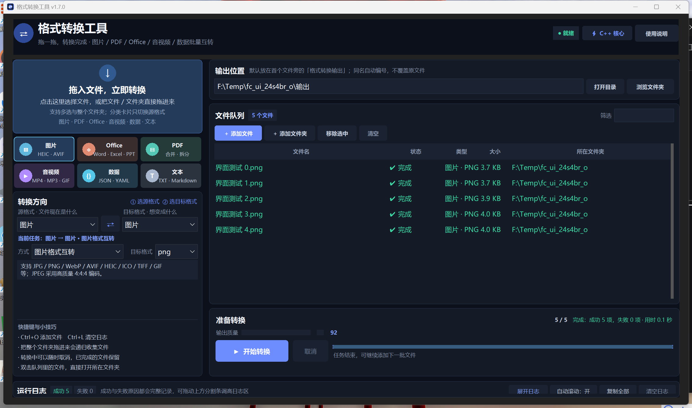

# 格式转换工具

[English](README.md) | [简体中文](README.zh-CN.md)

**一个开箱即用的 Windows 批量格式转换器**，把图片、PDF、Office、音视频、结构化数据的转换收进同一个窗口。拖进去、选方向、点开始，没有广告、没有会员、不联网。

> **v1.6.0 起，转换核心迁移到 C++17**（`cpp/`，CMake 构建）。Python/Tkinter 只负责界面、队列和进度；桌面端通过 `bin/fccli.exe` 调用 C++ 核心，Android 端通过 JNI 复用同一套代码。找不到 C++ 核心时仍可回退到 `converters_legacy.py`。

[](https://github.com/8848sing/format-converter/actions/workflows/ci.yml)




## 为什么是它

- **一个入口，30 种转换方式**：不用再为了转个格式满网找在线工具。
- **真批量**：整个文件夹拖进来，图片、PDF、音视频、数据转换多线程并行。图片按 CPU 逻辑线程数自动铺满并发（最多 16 路），视频转 MP4 检测到 NVIDIA 显卡时自动走 NVENC 硬件编码：20 秒 1080p 素材从 6.4 s 降到 2.7 s。
- **可取消、不覆盖**：随时停止后续任务；同名输出自动加 `_1`、`_2`，原文件永远不动。
- **纯本地**：转换全部在本机完成，不上传文件、不联网、不收集数据。
- **便携**：单个 exe 即可运行图片 / PDF / 数据 / 文本转换；带上 `tools/` 目录就能处理 Office 和音视频。
- **照片不会躺倒**：自动读取 EXIF 方向标记，手机拍的照片转出来方向正确。

## 功能一览

| 类别 | 输入 | 可以做什么 |
| --- | --- | --- |
| 图片 | JPG、PNG、WebP、AVIF、HEIC/HEIF、ICO、TIFF、BMP、GIF、TGA、PPM | 格式互转、每张转 PDF、多张合并 PDF、合成循环 GIF |
| PDF | PDF | 转图片（每页一张）、转可编辑 Word、转 Excel、转 PPT、转纯文本、合并、逐页拆分、旋转、内容流压缩 |
| Word | DOC、DOCX、RTF、ODT | 转 PDF、转图片、转纯文本、在 doc/docx/odt/rtf 之间互转 |
| Excel | XLS、XLSX、ODS、CSV | 转 PDF、转图片、在 xlsx/xls/ods/csv 之间互转、转 JSON |
| PPT | PPT、PPTX、ODP | 转 PDF、转图片、在 pptx/ppt/odp 之间互转 |
| 文本 | TXT、Markdown | 转 PDF、转 Word |
| 音频 | MP3、WAV、FLAC、M4A、AAC、OGG、OPUS、WMA、AIFF、AMR | 输出 MP3 / WAV / FLAC / M4A / AAC / OGG / OPUS / WMA |
| 视频 | MP4、M4V、MKV、MOV、WebM、AVI、WMV、FLV、TS、MTS、M2TS、3GP | 输出 MP4 / MKV / MOV / WebM / AVI / WMV / GIF，或提取音轨（MP4/MKV/MOV 有 NVIDIA 显卡时自动用 NVENC 硬件编码，失败自动回退软件编码） |
| 数据 | JSON、YAML、XML、XLSX、CSV | JSON / YAML / XML 互转、展开为 Excel、表格转 JSON |

完整注册表见 [`converters.py`](converters.py) 中的 `CONVERSIONS`，共 30 项。

## 快速开始

### 方式一：下载发布版

在 [Releases](../../releases) 页面下载最新版的 Windows 发布包（`format-converter-vX.Y.Z-win-x64.exe`），双击即可。首次运行若出现 SmartScreen「未知发布者」提示，是因为项目没有购买代码签名证书，选择「更多信息 → 仍要运行」即可。

### 方式二：从源码运行

```powershell
git clone https://github.com/8848sing/format-converter.git
cd format-converter
python -m pip install -r requirements.txt
python main.py
```

要求 Windows 10/11、Python 3.11 或 3.12（`pdf2docx` 对新版本 Python 的适配通常会滞后）。

### 方式三：构建 C++ 核心（推荐）

需要 CMake 3.20+ 和 C++17 编译器（MSVC 2022 / MinGW-w64）。PDFium 使用预编译包：

```powershell
# 下载 pdfium-win-x64.tgz 后解压到 cpp/third_party/pdfium-win
cmake -S cpp -B cpp/build -G "Visual Studio 17 2022" -A x64 `
  -DFC_PDFIUM_DIR="$PWD/cpp/third_party/pdfium-win"
cmake --build cpp/build --config Release
```

构建完成后 `bin/fccli.exe` 与 `bin/pdfium.dll` 会被自动复制，Python 界面优先调用它。
更完整的构建说明、CLI 用法、C API 和功能矩阵见 [`cpp/README.zh-CN.md`](cpp/README.zh-CN.md)。

### 自检

```powershell
python main.py --self-test
```

优先运行 C++ 核心的 `fccli self-test`（图片、PDF、数据基本链路 + LibreOffice/FFmpeg 检测）；
找不到 C++ 核心时回退到旧的 Python 全量自检。结果写入 `self-test-result.json`。
缺少 `tools/` 时，Office 与 FFmpeg 相关项会标记为失败。

## 关于 `tools/`

Office 与音视频转换依赖两个外部程序，体积很大（合计约 1.06 GB），因此**不进版本库**，需要自行放置：

```text
tools/
├─ FFmpeg/ffmpeg.exe
└─ LibreOffice/program/soffice.exe
```

- FFmpeg：从 [BtbN/FFmpeg-Builds](https://github.com/BtbN/FFmpeg-Builds) 下载 LGPL 构建，解压到 `tools/FFmpeg/`。
- LibreOffice：可使用 [LibreOffice Portable](https://www.libreoffice.org/download/portable-versions/)，解压到 `tools/LibreOffice/`。

也可以在程序根目录新建 `settings.json` 指定已有路径：

```json
{
  "ffmpeg": "tools/FFmpeg/ffmpeg.exe",
  "soffice": "C:/Program Files/LibreOffice/program/soffice.exe",
  "engine": "auto"
}
```

`engine` 可选 `auto`（默认）、`cpp`、`python`。设为 `python` 时强制走旧实现，
用于排查 C++ 核心问题；设为 `cpp` 时找不到 `fccli.exe` 会报错而不是回退。

来源、版本、SHA-256 与校验方法见 [`THIRD_PARTY_SECURITY.md`](THIRD_PARTY_SECURITY.md)。

## 打包

```powershell
python -m pip install -r requirements.txt pyinstaller
python -m PyInstaller --clean --noconfirm 格式转换工具.spec
```

产物在 `dist/格式转换工具.exe`。打包配置已关闭 UPX 以降低杀毒软件误报，并把 FFmpeg 保持为外置文件。`build/`、`dist/` 和 `*.exe` 均被 `.gitignore` 排除，发布请使用 GitHub Releases。

## 项目结构

```text
├─ main.py                  # 入口：高 DPI、--version、--self-test
├─ ui.py                    # Tkinter / ttkbootstrap 界面与线程调度
├─ converters.py            # 注册表 + C++ 桥接（C++ 优先、Python 回退）
├─ converters_legacy.py     # v1.5 的纯 Python 实现，仅作回退
├─ cpp_bridge.py            # 调用 bin/fccli.exe、解析 JSON 事件
├─ cpp/                     # C++17 核心：CMake、PDFium、libwebp、yaml-cpp
│  ├─ src/                  # 图片/PDF/Office/音视频/数据实现
│  ├─ include/fc/core.h     # 稳定 C API（JNI/ctypes 可调用）
│  ├─ android/              # Android JNI + Gradle 外壳
│  └─ README.zh-CN.md       # C++ 构建与功能矩阵
├─ bin/                     # fccli.exe + pdfium.dll（构建产物，git 忽略）
├─ version.py               # 版本号唯一来源
├─ self_test.py             # C++ 优先的全功能自检
├─ tests/test_registry.py   # 注册表结构测试（无第三方依赖）
├─ docs/screenshot.png      # 界面截图
├─ tools/                   # LibreOffice / FFmpeg，git 忽略
├─ requirements.txt
└─ 格式转换工具.spec         # PyInstaller 配置（自动打包 bin/）
```

## 设计说明

- **C++ 核心 + Python 界面分离**：转换、并发、PDFium/FFmpeg/LibreOffice 调度都在 `cpp/`；`converters.py` 只保留注册表和桥接。桌面端用 `fccli` 子进程，Android 用 JNI，二者共享同一份 C++ 代码。
- **统一异常**：C++ 内部抛 `fc::Error`，CLI 转成 `{"type":"file_error"}` 事件；Python 侧仍抛 `ConvertError`，界面逐文件捕获，单个文件失败不会中断整批。
- **有界并发**：C++ 引擎按任务类型设置 1～4 路（图片按 CPU 逻辑线程数自动升到最多 16 路），不会一次性提交几万个任务；PDFium 调用额外串行化，避免库内部非线程安全。
- **输出占位**：`OutputAllocator` 用锁登记已分配文件名，并行转换也不会互相覆盖；输出先写 `.part` 再改名。
- **UTF-8 路径**：Windows 下路径统一从 UTF-8 转宽字符，中文/空格路径不会被 ANSI 解码破坏。
- **不经过 shell**：LibreOffice/FFmpeg 一律用参数数组启动，文件名不会被解释成命令。
- **可回退**：找不到 `bin/fccli.exe` 或 `settings.json` 设置 `"engine": "python"` 时，`converters.py` 自动使用 `converters_legacy.py`。

## 更新日志

### 未发布（main 分支上的修复与优化）

- **修复：界面里转音视频会卡死**。子进程原来继承了 `fccli` 的标准输入（一个一直开着的管道），FFmpeg 会挂在等待 stdin 上，表现为进度不动、CPU 0%、输出 0 字节、只能等 30 分钟超时。现在子进程的标准输入一律接到 NUL，并给 FFmpeg 加 `-nostdin`；20 秒 1080p 转 MP4 / MKV / 提取 MP3 分别为 2.8 s / 2.9 s / 0.3 s。
- **视频硬件编码**：输出 MP4 / MKV / MOV 时先探测 `ffmpeg -encoders`，有 `h264_nvenc` 就走显卡编码（`-cq 28 -maxrate 16M`），1080p30 从 6.4 s 降到 2.7 s，同码率画质 SSIM 也从 0.982 升到 0.993；NVENC 初始化失败时自动回退 `libopenh264`，不会让用户看到莫名的失败。
- **图片并发铺满 CPU**：图片任务的自动并发从「最多 8 路」改成按逻辑线程数（最多 16 路）。12 线程机器上 40 张 3200×2000 转 WebP 从 3.7 s 降到 3.2 s。
- **窗口尺寸自适应**：窗口改为按 Windows 工作区（扣掉任务栏）计算，150% 缩放的 2560×1440 屏上不再只开出 1678×959 的小窗口；恢复上次窗口大小时也会收回屏幕内，底部日志区不再被任务栏压住。
- **拖拽区文案不再被裁**：卡片高度按实际内容增加，最后一行「图片 · PDF · Office · 音视频 · 数据 · 文本」完整显示。

### v1.7.0（桌面端）

- **批量单进程**：一整批文件交给一个 `fccli` 进程，由核心在进程内并发；40 张小图从 0.80 s 降到 0.22 s。
- **真取消**：`fccli convert --job-line -` 支持 stdin 取消指令，在文件之间停止派发，不留 `.part` 半成品。
- **打包瘦身**：剔除 Python 回退里用不到的 OpenCV / PyMuPDF / pdf2docx，exe **127.6 MB → 56.5 MB**，启动约快 25%。
- **AVIF 可用**：系统没有 AVIF 编码器时自动改用 `tools/FFmpeg` 的 libsvtav1 兜底，质量滑杆同样生效。
- **Office 更稳**：子进程树用 Windows 作业对象托管，超时就整棵树收掉（不再残留 `soffice.bin` 锁死后续转换）；单文件超时收紧到 120 s。
- **Word 转文本默认内置提取**：`.docx` 走 `docx_text`（0.14 s），`.doc`/`.rtf`/`.odt` 仍用 LibreOffice，失败自动回退；可在设置里改回「LibreOffice 优先」。
- **界面**：队列状态列、图片质量滑杆、渲染 DPI、并发数、失败一键重试、队列关键字筛选、引擎徽标、设置窗口、偏好记忆、日志折叠、结束提示音；高分屏下不再超出屏幕。
- **打包**：exe 增加 per-monitor v2 DPI 声明，125%/150% 缩放下界面不再发虚。
- 新增 `sync_version.py` 同步三处版本号，`settings_store.py` 统一读写 `settings.json`。

### v1.6.0

- **核心迁移到 C++17**：新增 `cpp/`、`fccli.exe`、`fccore.dll` 与稳定 C API；图片、PDF、Office、音视频、数据转换全部由 C++ 调度。
- **Android 起步**：新增 `cpp/android/` JNI、Java 界面和 Gradle 工程；首版支持图片、PDF、数据转换。
- Python 界面改为「C++ 优先、Python 回退」；`converters_legacy.py` 保留旧实现。
- C++ 核心内置：stb、libwebp、PDFium、yaml-cpp、miniz、tinyxml2、gif.h；Office/FFmpeg 仍复用 `tools/`。
- 修复中文/空格路径在 Windows 窄字符串转换下的兼容问题；输出统一 `.part` 原子落盘。
- 自检优先运行 `fccli self-test`；PyInstaller 配置自动打包 `bin/fccli.exe` 与 `bin/pdfium.dll`。

### v1.5.0

- 图片批量转换按 CPU 核数自动提升并发（最多 8 路），多核机器吞吐更高。
- WebP 改用更快的编码档位，体积基本不变，速度约提升四成。
- PNG 去掉收益极低的穷举压缩，转换速度约提升一倍。
- 手机照片自动应用 EXIF 方向，不再出现横躺或倒置。
- PDF 转纯文本改用 pypdfium2 原生提取，大文档明显更快，提不到时自动回退 pdfplumber。
- 输出位置旁新增「打开目录」按钮；双击队列文件可直接打开所在文件夹。
- 修复：Office 产出空文件被误算成功；批次级失败时进度条卡住、成功/失败数对不上。
- 修复：图片转 PDF / 合并 PDF 未及时释放文件句柄；大批量转换时内存峰值更低。

## 已知限制

- **PDF 转 Word / Excel** 为 C++ 原生实现：提取文字层写入 DOCX/XLSX，版式和表格结构不如 `pdf2docx` 精细；扫描件需要先 OCR。
- PDF 转 PPT 是「整页图片版」，文字不可编辑。
- PDF 压缩是结构重写，不会重新压缩已嵌入的高清图片。
- **AVIF 编码**依赖系统 WIC 编码器；Windows 默认通常没有安装 AV1/AVIF 扩展，此时会提示改用 PNG/WebP。HEIC/AVIF 的**解码**同样依赖系统扩展；TIFF/ICO 走系统 WIC。
- 压缩包内没有 `tools/` 时，Office 和音视频转换会提示找不到 LibreOffice / FFmpeg。
- Android 不支持 Office 与音视频（需要额外集成 LibreOffice/FFmpeg 库）；图片输入支持 JPEG/PNG/WebP/BMP/GIF/TGA/PPM/ICO，HEIC/HEIF/AVIF 通过系统解码器读取；TIFF 暂不支持解码。
- 没有商业代码签名，SmartScreen 可能提示「未知发布者」。
- 界面目前只有中文；文档提供中英双语。

## Android

C++ 核心已经带 JNI 与 Java 外壳，位于 [`cpp/android/`](cpp/android/README.zh-CN.md)，已在雷电模拟器（Android 14 x86_64）实测通过。

- 覆盖图片、PDF、数据转换；Office/音视频待接入 FFmpeg 与文档引擎。
- 界面为 Material 3：「类别 → 转换方式 → 目标格式」三级胶囊，深色模式、自适应图标、折叠日志。
- 事件流式回调：进度条按文件实时推进，可随时「取消」，已完成文件保留。
- 结果自动发布到媒体库（图片进 `Pictures/格式转换工具`，其它进 `Download/格式转换工具`），可直接分享。
- 支持从其它应用「分享到」本应用或用本应用打开图片/PDF。
- 内置「自检」按钮，一键验证 18 条转换链路。
- 构建需要 Android Studio、NDK 27、PDFium Android 预编译包，且工程路径必须是纯 ASCII。

## 参与贡献

欢迎提 Issue 和 PR，提交前请先看 [`CONTRIBUTING.zh-CN.md`](CONTRIBUTING.zh-CN.md)。CI 会运行 Ruff、语法编译和注册表测试。

## 许可证

本项目以 [MIT License](LICENSE) 开源。随包分发的 FFmpeg 为 LGPL 构建，LibreOffice 为 MPL 2.0，二者遵循各自许可证，详见 [`THIRD_PARTY_SECURITY.zh-CN.md`](THIRD_PARTY_SECURITY.zh-CN.md)。