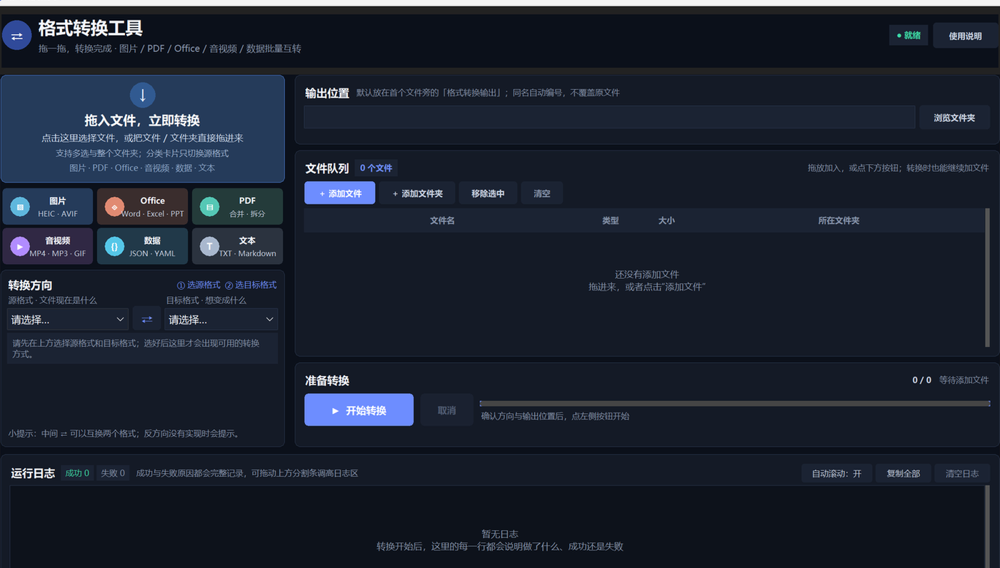

# 格式转换工具

[English](README.md) | [简体中文](README.zh-CN.md)

**一个开箱即用的 Windows 批量格式转换器**，把图片、PDF、Office、音视频、结构化数据的转换收进同一个窗口。拖进去、选方向、点开始，没有广告、没有会员、不联网。

[](../../actions/workflows/ci.yml)




## 为什么是它

- **一个入口，30 种转换方式**：不用再为了转个格式满网找在线工具。
- **真批量**：整个文件夹拖进来，图片、PDF、音视频、数据转换多线程并行。8 张 3200×2000 图片转 WebP，从 8.4 s 降到 2.6 s。
- **可取消、不覆盖**：随时停止后续任务；同名输出自动加 `_1`、`_2`，原文件永远不动。
- **纯本地**：转换全部在本机完成，不上传文件、不联网、不收集数据。
- **便携**：单个 exe 即可运行图片 / PDF / 数据 / 文本转换；带上 `tools/` 目录就能处理 Office 和音视频。
- **照片不会躺倒**：自动读取 EXIF 方向标记，手机拍的照片转出来方向正确。

## 功能一览

| 类别 | 输入 | 可以做什么 |
| --- | --- | --- |
| 图片 | JPG、PNG、WebP、AVIF、HEIC/HEIF、ICO、TIFF、BMP、GIF、TGA、PPM | 格式互转、每张转 PDF、多张合并 PDF、合成循环 GIF |
| PDF | PDF | 转图片（每页一张）、转可编辑 Word、转 Excel、转 PPT、转纯文本、合并、逐页拆分、旋转、内容流压缩 |
| Word | DOC、DOCX、RTF、ODT | 转 PDF、转图片、转纯文本、在 doc/docx/odt/rtf 之间互转 |
| Excel | XLS、XLSX、ODS、CSV | 转 PDF、转图片、在 xlsx/xls/ods/csv 之间互转、转 JSON |
| PPT | PPT、PPTX、ODP | 转 PDF、转图片、在 pptx/ppt/odp 之间互转 |
| 文本 | TXT、Markdown | 转 PDF、转 Word |
| 音频 | MP3、WAV、FLAC、M4A、AAC、OGG、OPUS、WMA、AIFF、AMR | 输出 MP3 / WAV / FLAC / M4A / AAC / OGG / OPUS / WMA |
| 视频 | MP4、M4V、MKV、MOV、WebM、AVI、WMV、FLV、TS、MTS、M2TS、3GP | 输出 MP4 / MKV / MOV / WebM / AVI / WMV / GIF，或提取音轨 |
| 数据 | JSON、YAML、XML、XLSX、CSV | JSON / YAML / XML 互转、展开为 Excel、表格转 JSON |

完整注册表见 [`converters.py`](converters.py) 中的 `CONVERSIONS`，共 30 项。

## 快速开始

### 方式一：下载发布版

在 [Releases](../../releases) 页面下载 `格式转换工具.exe`，双击即可。首次运行若出现 SmartScreen「未知发布者」提示，是因为项目没有购买代码签名证书，选择「更多信息 → 仍要运行」即可。

### 方式二：从源码运行

```powershell
git clone https://github.com/8848sing/format-converter.git
cd format-converter
python -m pip install -r requirements.txt
python main.py
```

要求 Windows 10/11、Python 3.11 或 3.12（`pdf2docx` 对新版本 Python 的适配通常会滞后）。

### 自检

```powershell
python main.py --self-test
```

会依次跑一遍图片、PDF、Office、音视频、数据转换，结果写入 `self-test-result.json`。缺少 `tools/` 时，Office 与 FFmpeg 相关项会标记为失败。

## 关于 `tools/`

Office 与音视频转换依赖两个外部程序，体积很大（合计约 1.06 GB），因此**不进版本库**，需要自行放置：

```text
tools/
├─ FFmpeg/ffmpeg.exe
└─ LibreOffice/program/soffice.exe
```

- FFmpeg：从 [BtbN/FFmpeg-Builds](https://github.com/BtbN/FFmpeg-Builds) 下载 LGPL 构建，解压到 `tools/FFmpeg/`。
- LibreOffice：可使用 [LibreOffice Portable](https://www.libreoffice.org/download/portable-versions/)，解压到 `tools/LibreOffice/`。

也可以在程序根目录新建 `settings.json` 指定已有路径：

```json
{
  "ffmpeg": "tools/FFmpeg/ffmpeg.exe",
  "soffice": "C:/Program Files/LibreOffice/program/soffice.exe"
}
```

来源、版本、SHA-256 与校验方法见 [`THIRD_PARTY_SECURITY.md`](THIRD_PARTY_SECURITY.md)。

## 打包

```powershell
python -m pip install -r requirements.txt pyinstaller
python -m PyInstaller --clean --noconfirm 格式转换工具.spec
```

产物在 `dist/格式转换工具.exe`。打包配置已关闭 UPX 以降低杀毒软件误报，并把 FFmpeg 保持为外置文件。`build/`、`dist/` 和 `*.exe` 均被 `.gitignore` 排除，发布请使用 GitHub Releases。

## 项目结构

```text
├─ main.py                 # 入口：高 DPI、--version、--self-test
├─ ui.py                   # Tkinter / ttkbootstrap 界面与线程调度
├─ converters.py           # 全部转换实现 + CONVERSIONS 注册表
├─ version.py              # 版本号唯一来源
├─ self_test.py            # 全功能自检
├─ tests/test_registry.py  # 注册表结构测试（无第三方依赖）
├─ docs/screenshot.png     # 界面截图
├─ tools/                  # 外部二进制，git 忽略
├─ requirements.txt
└─ 格式转换工具.spec        # PyInstaller 配置
```

## 设计说明

- 转换逻辑与界面分离：`converters.py` 只依赖标准库和按需导入的第三方库，启动时不会加载重型依赖。
- 统一异常：转换失败抛 `ConvertError`，界面逐文件捕获，单个文件失败不会中断整批任务。
- 有界并发：按任务类型设置 2～4 个线程，并只提前排队 2 倍任务，避免几万个文件一次性占满内存。
- 输出占位：并行转换时用锁登记已分配的文件名，避免同名文件互相覆盖。
- 调用外部程序一律使用参数数组，不经过 shell，文件名不会被解释成命令。

## 更新日志

### v1.5.0

- 图片批量转换按 CPU 核数自动提升并发（最多 8 路），多核机器吞吐更高。
- WebP 改用更快的编码档位，体积基本不变，速度约提升四成。
- PNG 去掉收益极低的穷举压缩，转换速度约提升一倍。
- 手机照片自动应用 EXIF 方向，不再出现横躺或倒置。
- PDF 转纯文本改用 pypdfium2 原生提取，大文档明显更快，提不到时自动回退 pdfplumber。
- 输出位置旁新增「打开目录」按钮；双击队列文件可直接打开所在文件夹。
- 修复：Office 产出空文件被误算成功；批次级失败时进度条卡住、成功/失败数对不上。
- 修复：图片转 PDF / 合并 PDF 未及时释放文件句柄；大批量转换时内存峰值更低。

## 已知限制

- PDF 转 Word / Excel / PPT 依赖原文件的文字层与结构；扫描件需要先做 OCR。
- PDF 转 PPT 是「整页图片版」，文字不可编辑。
- PDF 压缩只处理内容流和重复对象，不会重新压缩已嵌入的高清图片。
- 压缩包内没有 `tools/` 时，Office 和音视频转换会提示找不到 LibreOffice / FFmpeg。
- 没有商业代码签名，SmartScreen 可能提示「未知发布者」。
- 界面目前只有中文；文档提供中英双语。

## 参与贡献

欢迎提 Issue 和 PR，提交前请先看 [`CONTRIBUTING.zh-CN.md`](CONTRIBUTING.zh-CN.md)。CI 会运行 Ruff、语法编译和注册表测试。

## 许可证

本项目以 [MIT License](LICENSE) 开源。随包分发的 FFmpeg 为 LGPL 构建，LibreOffice 为 MPL 2.0，二者遵循各自许可证，详见 [`THIRD_PARTY_SECURITY.zh-CN.md`](THIRD_PARTY_SECURITY.zh-CN.md)。